  

<pre>
<b>subhojit@github:~$ cat about.txt</b>
Second-year Computer Science student at the University of Warwick.
Interested in AI/ML, software engineering, automation and cybersecurity.
I enjoy building practical applications and systems that solve
real-world problems, from machine learning to network automation.

<b>subhojit@github:~$ ls ~/projects</b>
Stock-Price-Predictor  ML-powered stock prediction dashboard
Bill-Splitter-Deluxe   Expense-sharing platform with debt verification
CrediWise              AI-powered financial literacy mobile app

<b>subhojit@github:~$ cat experience.txt</b>
Jio        Software Engineering Intern (Jul–Sep 2026)
           Deployed 4 full-stack network automation applications
Barclays   Technology Developer Discovery Programme (Apr 2026)
           Secured a 2027 Technology Developer Summer Internship offer
IBM        CSRBOX SkillsBuild Programme (Jun 2024)
Warwick    BSc Computer Science (2025–2028)

<b>subhojit@github:~$ cat stack.yml</b>
languages: [Python, Java, C++, JavaScript, TypeScript, Haskell, SQL]
backend:   [Flask, FastAPI, Node.js, SQLAlchemy]
web:       [HTML, CSS, React Native, Expo, jQuery, AJAX]
ml/data:   [Scikit-learn, Pandas, NumPy, XGBoost]
database:  [Firebase, MongoDB, SQL]
tools:     [Git, GitHub, VS Code, Vercel]

<b>subhojit@github:~$ cat contact.txt</b>
web       <a href="https://subhojitghosh.vercel.app/">subhojitghosh.vercel.app</a>
github    <a href="https://github.com/subhojitghosh712">github.com/subhojitghosh712</a>
linkedin  <a href="https://www.linkedin.com/in/ghoshsubhojit/">linkedin.com/in/ghoshsubhojit</a>
email     <a href="mailto:Subhojit.Ghosh@warwick.ac.uk">Subhojit.Ghosh@warwick.ac.uk</a>

<b>subhojit@github:~$</b> █
</pre>
